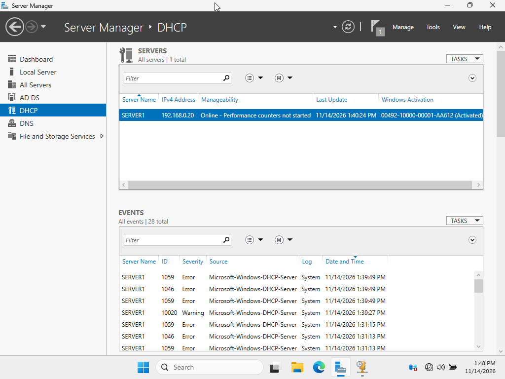
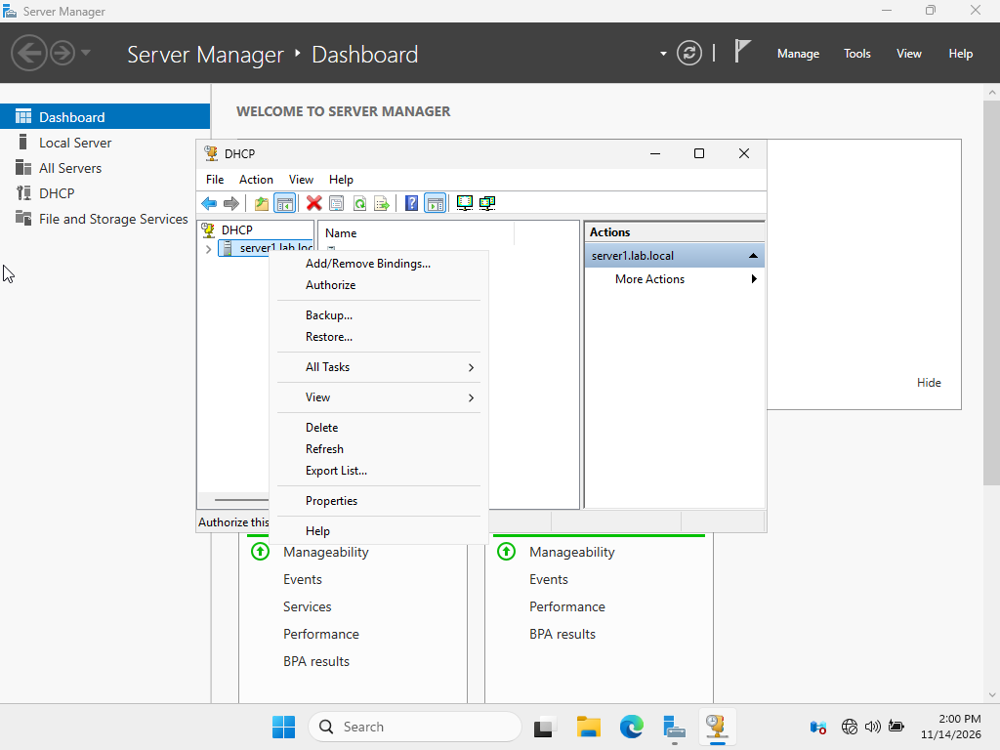
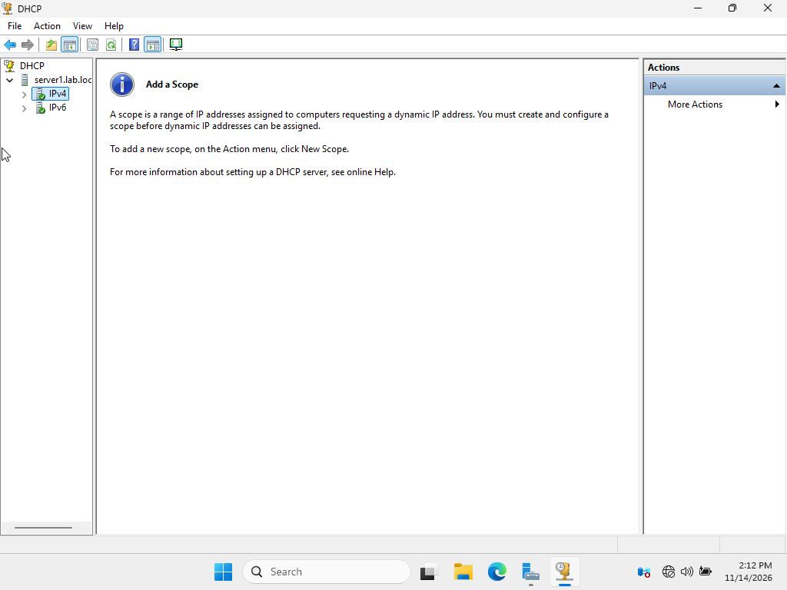
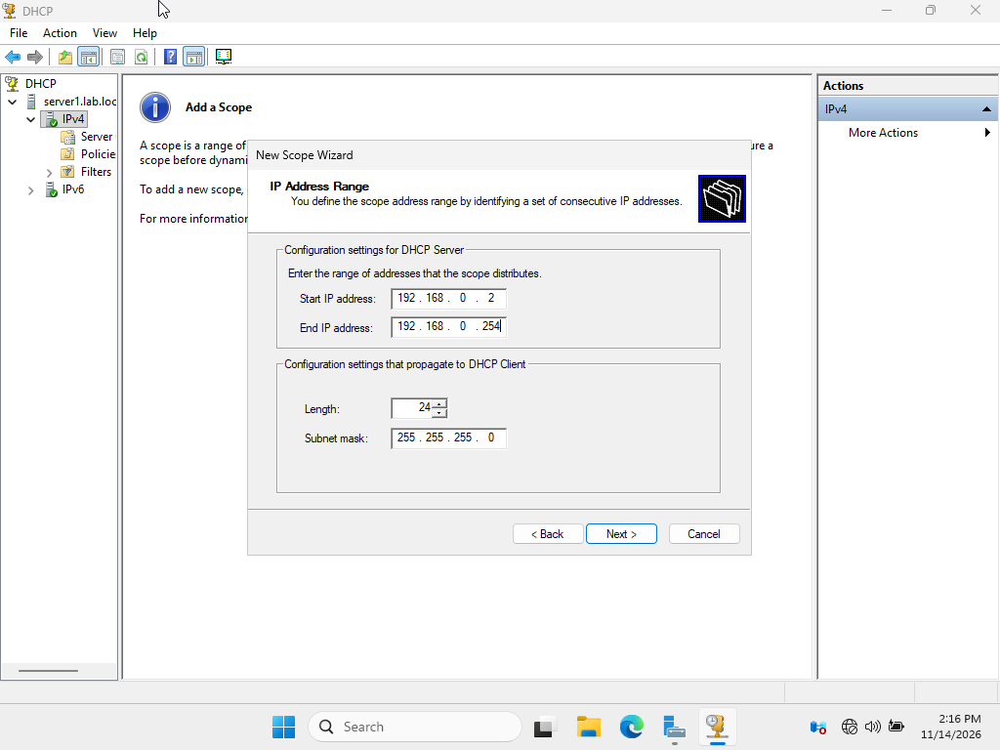
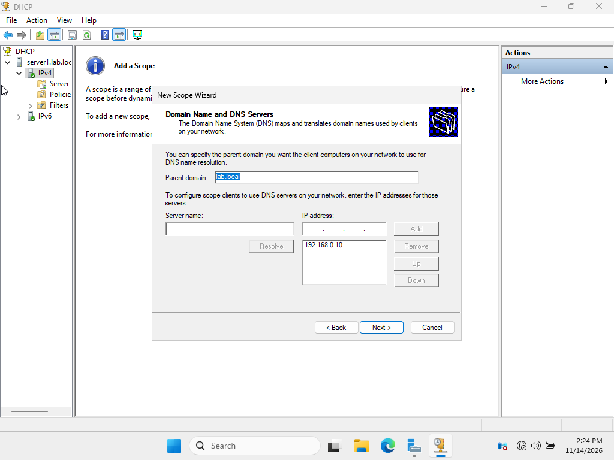
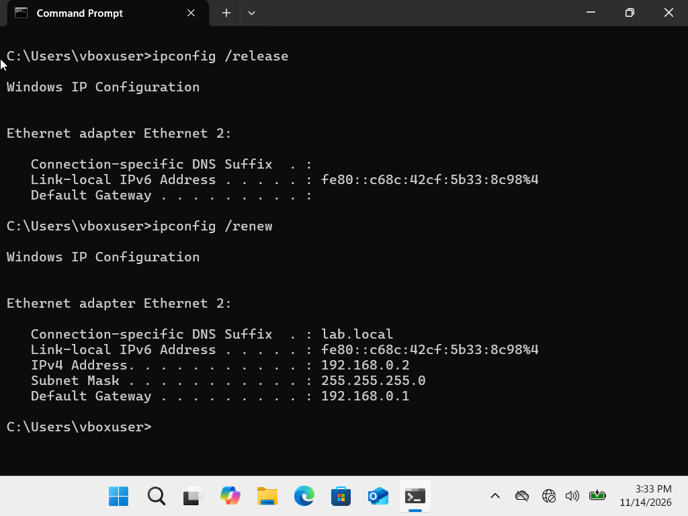

# Authorize DHCP Server 
In real world environments, it is best to keep your DHCP server seperate from the DC

1) Ensure that both DC1 and Server1 VM are on
    - Log in with the DOMAIN ADMIN CREDENTIALS
2) Go to DC1 VM and install the DHCP Server Tools feature if not done already

  
   
  <em>Installing DHCP Server Tools</em>

3) After install, I clicked on "DHCP" on the left side within Server Manager

  
   
  <em>Verifying if Server1 populates</em>

4) I switched over to Server1, and opened up Server Manager. Then, I clicked on "Tools" -> "DHCP"

  
   
  <em>DHCP GUI</em>

5) I right click on "server1.lab.local" and clicked on "Authorize"

  
   
  <em>Authorizing the DHCP Server</em>

6) Click on IPv4 and it should change from red down arrow to green

  
   
  <em>Confirmed Authorization</em>

# Setup DHCP Scope
1) I right clicked on IPv4 and clicked on "New Scope"

  
   
  <em>DHCP Scope Options</em>

2) I input the desired name and description
    - It is best practice to utilize naming conventions and descriptions for organizations purposes
3) I also input the IP addresses that I wanted to exclude. INPUT THE DNS SERVER!!!
    - Other IP addresses go in here as well (i.e. printers)

<table>
  <tr>
    <td align="center">
      
       
      <em>DHCP Name and Description</em>
    </td>
    <td align="center">
      
       
      <em>DHCP Exclusion</em>
    </td>
  </tr>
</table>

4) Input the desired DHCP range as well.

For the purposes of this lab, I will use the following DHCP scope  
Start IP Address: 192.168.0.2  
End IP Address: 192.168.0.254

  
   
  <em>DHCP Range</em>

5) For the DHCP Lease, it is up to the SysAdmin on what it should be. Be mindful of when people come and go

  
   
  <em>DHCP Lease</em>

6) In a real world environment, your DHCP server will be connected to a router. Input the default gateway IP address for your scope.

    - Also configure your router to have the default gateway IP address

  
   
  <em>Router (Default Gateway)</em>

7) Verify the DNS Server

  
   
  <em>DNS Server</em>

8) Verify if DHCP Scope is good

  
   
  <em>DHCP Scope Active</em>

# Test DHCP Server  
1) Start up the Win11 Client VM  
2) I checked if a static IP Address is assigned or not. If it is, change it to automatically  

<table>
  <tr>
    <td align="center">
      
       
      <em>Static IP Address</em>
    </td>
    <td align="center">
      
       
      <em>Change to Automatic</em>
    </td>
  </tr>
</table>

3) By default, the Win11 Client VM will automatically obtain a DHCP address. If not, I would use these commands to gain a DHCP address

    ipconfig /release
    ipconfig /renew
    ipconfig /all

  
   
  <em>Commands for DHCP</em>

4) Verify if the new IP adddress belongs in the correct DHCP range  

  
   
  <em>DHCP Address accquired</em>

# Install Additional DHCP Server  
It is best to have two of anything. This allows for high availability and redundancy  
There are two modes for configuring failover:  
Hot Standby - One DHCP Server on, One DHCP Server off  (If one fails, the other becomes active)
Load Balance - Both DHCP Servers on  (Both distribute DHCP traffic)

# Implement and Test Failover Solution  

# Troubleshoot common DHCP scenarios  