# Server 1 VM not populating within DC1
In order to authorize a DHCP server, a domain admin account must authorize it within Server Manager. This process happens within DC1 VM in this lab environment. First I went to Server Manager, Then I clicked on "Manage" at the top right to add Server1 in DC1's list of server. 

<table>
  <tr>
    <td align="center">
      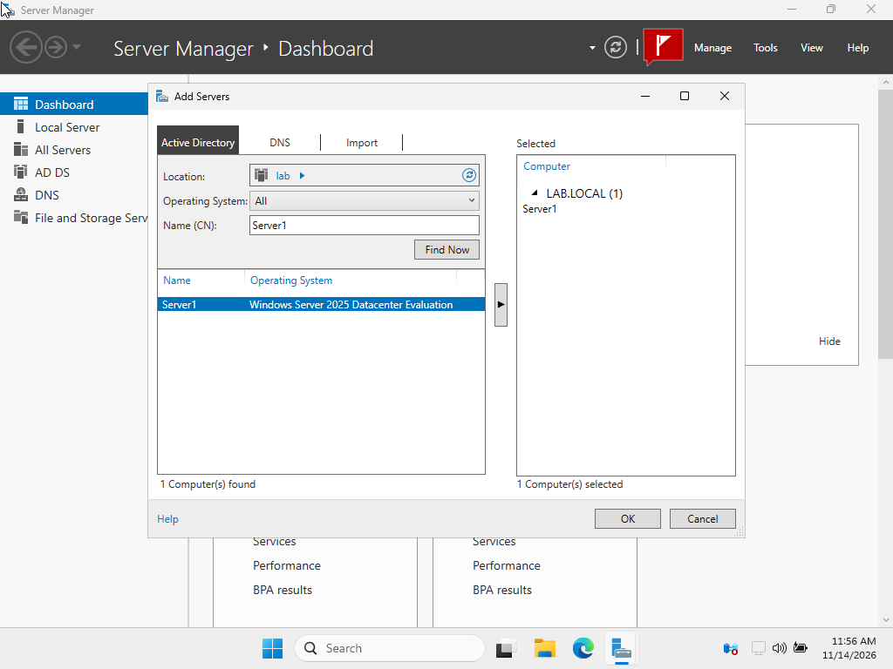
       
      <em>Adding Server1</em>
    </td>
    <td align="center">
      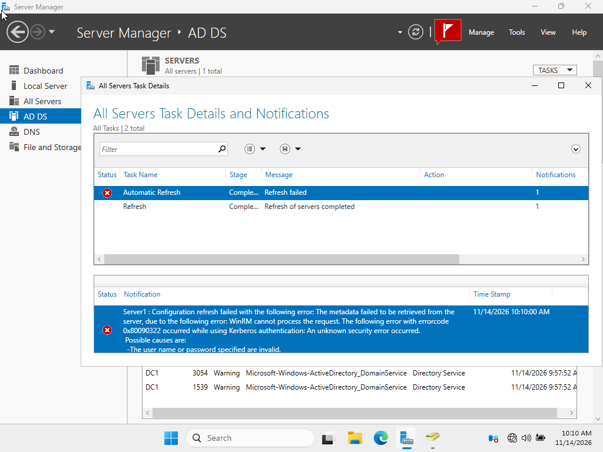
       
      <em>Trying to add Server1</em>
    </td>
  </tr>
</table>

I tried adding Server1 with the local admin account. That did not work initially. So I switched to the domain admin account. 

  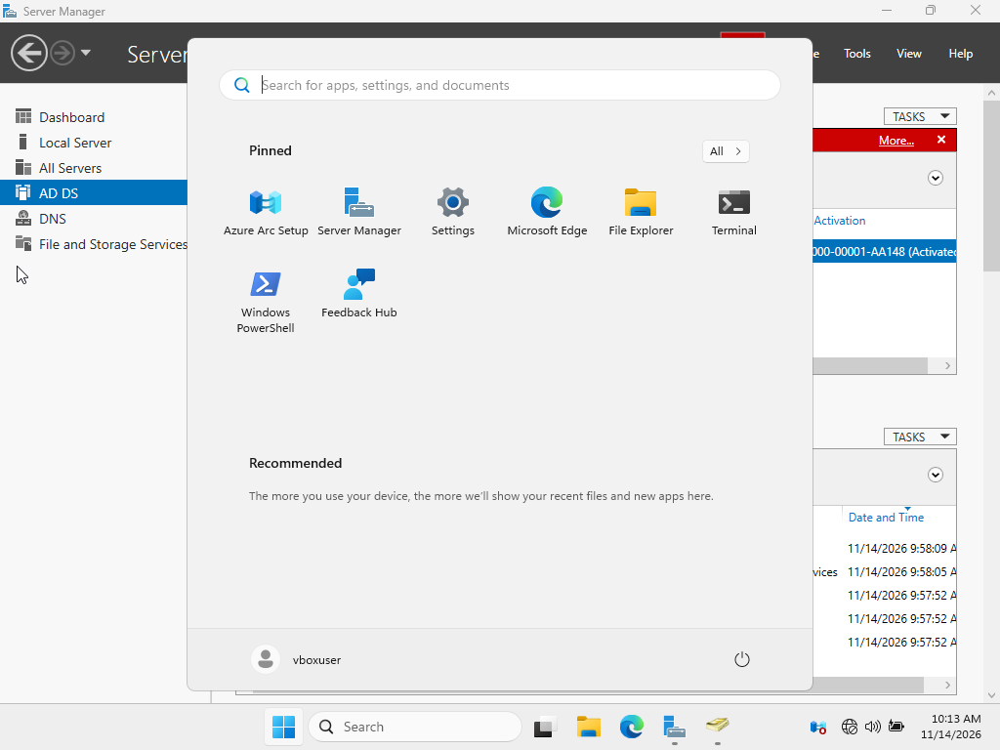
   
  <em>Not logged in with Domain Admin Account</em>

After adding Server1 with the domain admin account, an error appeared stating "Kerberos Error." 

  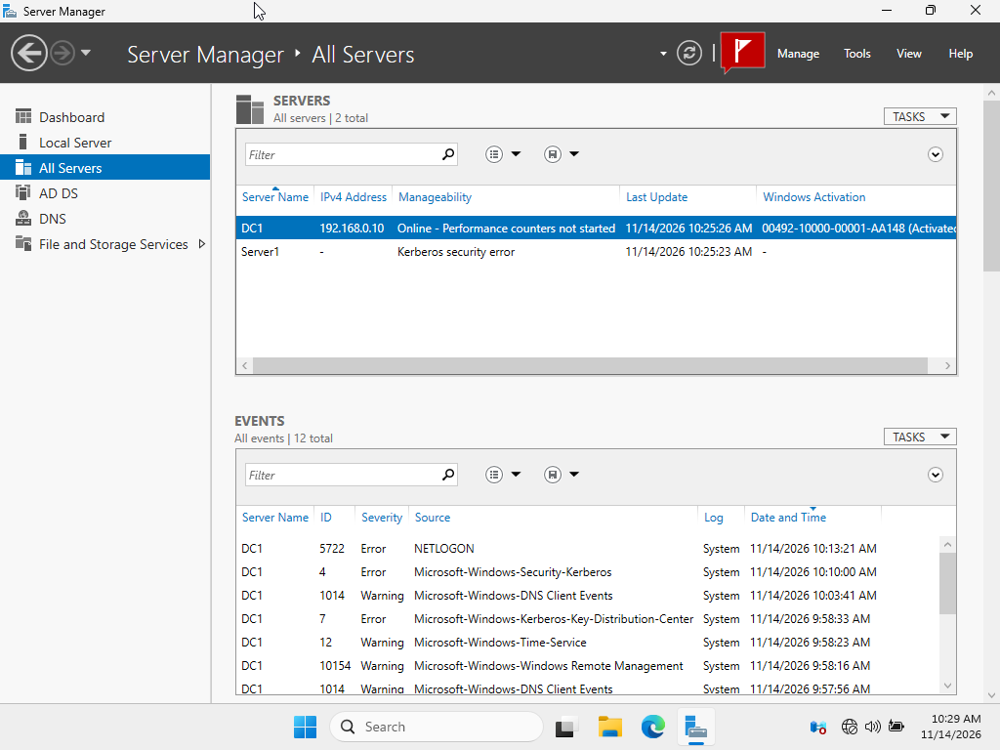
   
  <em>Authentication Error</em>

So I tried logging into Server1 with the domain credentials. The following appeared.

  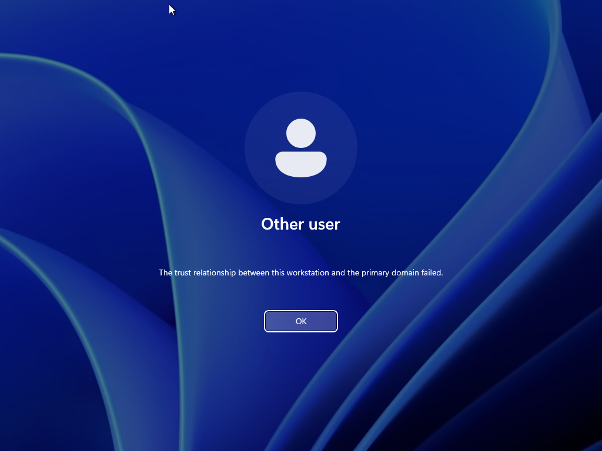
   
  <em>Logging in with Domain Admin Creds into Server1</em>

So I logged into Server1 with the local admin account and used the following commands

    Test-ComputerSecureChannel -Verbose

  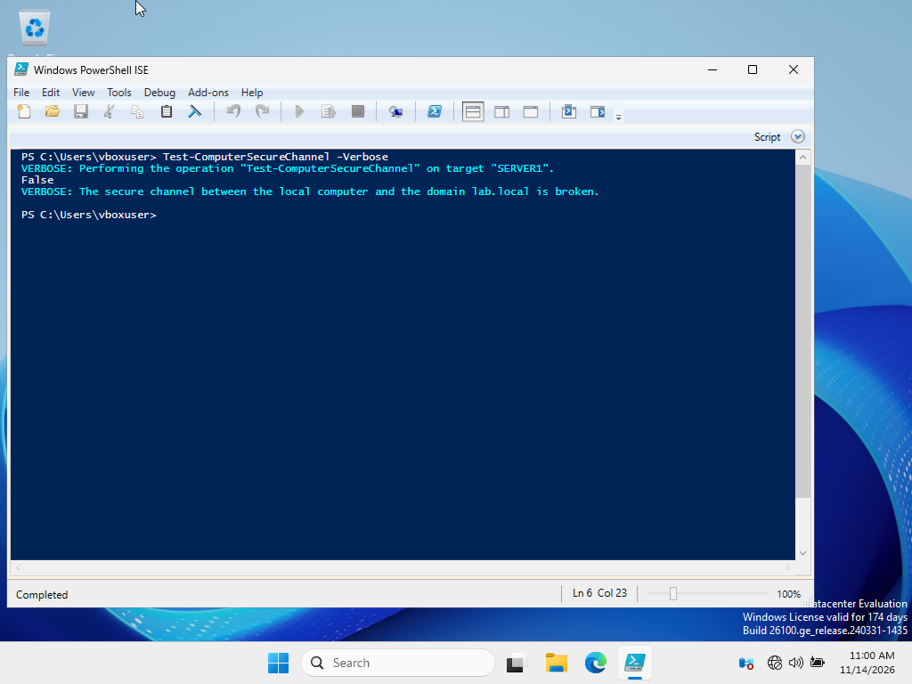
   
  <em>Testing SecureChannel</em>

This returned false, which verifies that the trust relationship status is broken
To fix this, I used this command

    Test-ComputerSecureChannel -Repair -Credential (Get-Credential)

  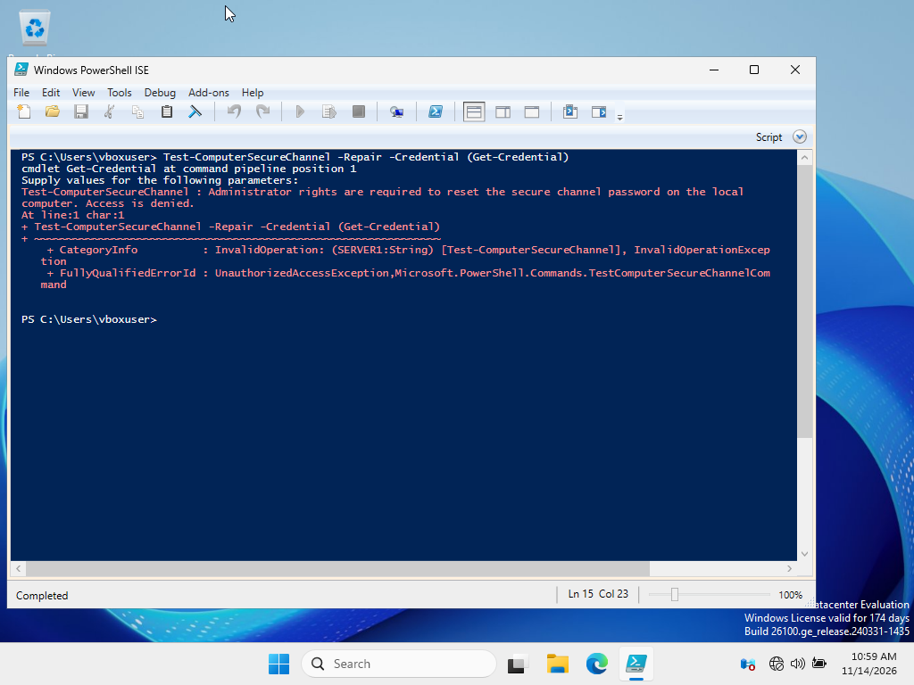
   
  <em>Command fails</em>

I thought this would work. However, even after providing the credentials, an error appears stating that the action is not authorized. BEST THING TO DO IS RE-JOIN SERVER1 FROM SCRATCH

# Server VM not populating within DC1 due to Computed Packet Size
So after fixing the debacle with Server1's trust being broken, I tried adding Server1 again to DC1's list of server. A new error appeared

  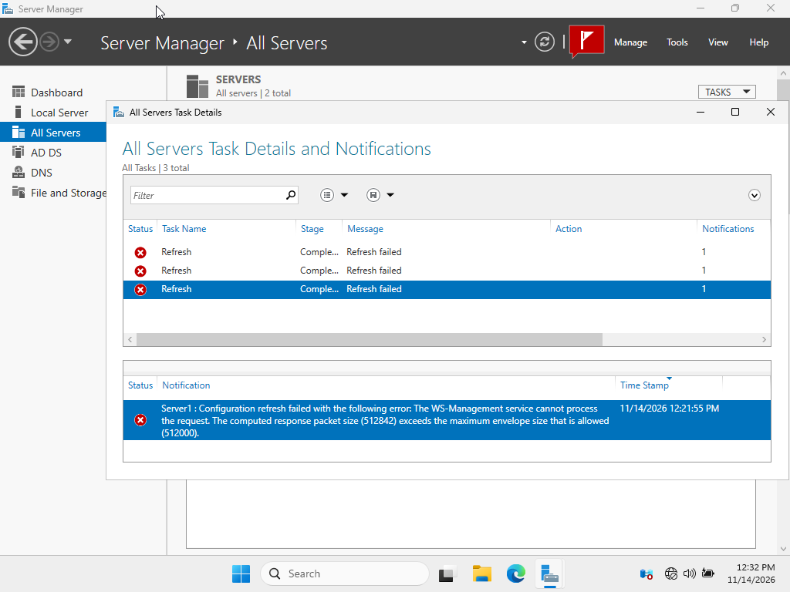
   
  <em>WS-Management Packet Size Error</em>

To fix this, I used the following commands on BOTH DC1 and Server1

    winrm get winrm/config
        - Look for MaxEnvelopSizekb = 500

  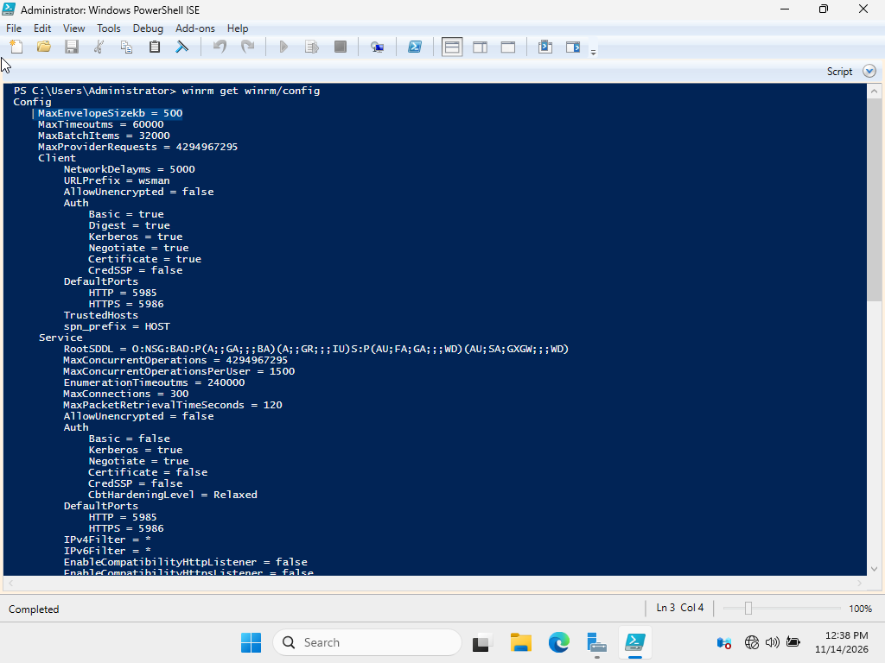
   
  <em>WinRm Config</em>

    winrm set winrm/config '@{MaxEnvelopeSizekb="8192"}'
    Restart-Service WinRM

<table>
  <tr>
    <td align="center">
      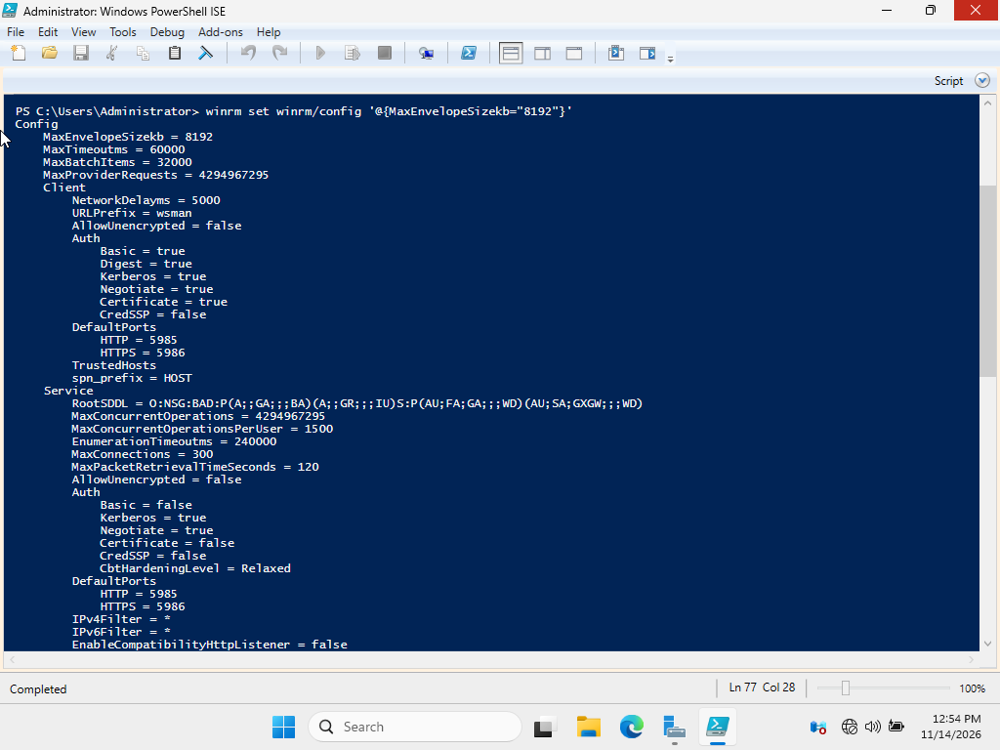
       
      <em>MaxEnvelopeSize Change</em>
    </td>
    <td align="center">
      
       
      <em>Restarting the WinRm Service</em>
    </td>
  </tr>
</table>

Close out Service Manager on DC1 and reopen it to try adding it again

  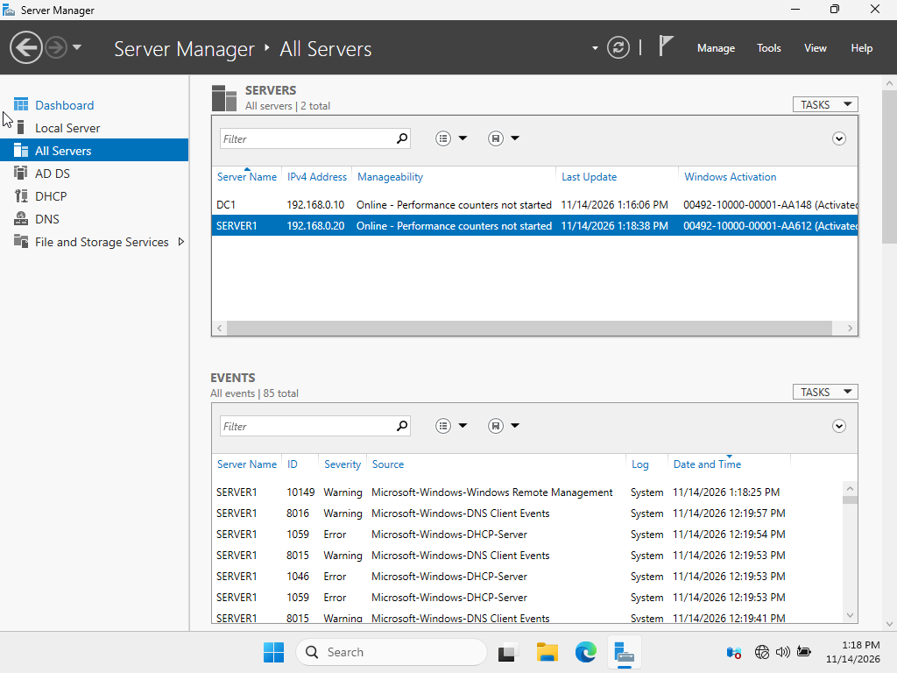
   
  <em>Server1 Added to DC1's Server List</em>

