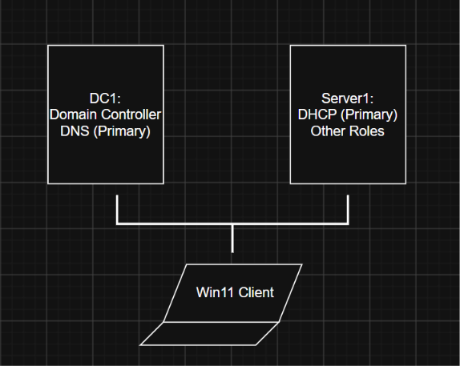

# Title
Windows(DHCP)

# Author
Brent Haven Dancel

# Tools/Technologies Used
Oracle VirtualBox Hypervisor
Windows Server VM 1 (DC1 w/ AD DS and DNS Installed)
Windows Server VM 2 (Server1 w/ DHCP Installed)
Windows 11 Home Edition VM (Win11Client)

# Description
Purpose: Demonstrate proficiency with DHCP Windows Services

1) Authorize DHCP Server  
2) Setup DHCP Scope  
3) Test DHCP Server  
4) Install Additional DHCP Server  
5) Implement and Test DHCP Failover  
6) Troubleshoot DHCP Scenarios  

# How to Use/Navigate  
DHCP-documentation.md will show the steps that I took for configuring the options for DHCP
DHCP-troublehshooting.md will show what issues I encountered

DHCPTrouble.ps1 will purposefully cause problems and it will be randomized
It is up to you to try to fix the problem

# Additional Notes  
This lab is after post-install of the DHCP Server Role

My repositories (WinLabServerRoles and VirtualWinLabSetup) show what the lab setup looks like. If you want to run this lab, you can do so!

  
   
  <em>Virtual Windows Lab Setup</em>

